# Decisions and their effect

What was chosen at each fork in the hail and asset work, what the alternatives were, and how much the choice moves the result. Orange marks the option in use. Every number and chart is computed by `python -m crc_lab.decisions` from the built tables (plant table built 2026-11-10). Texas solar plants are the running example; Fighting Jays in Fort Bend County, badly damaged by hail in March 2024, is the test case.

## 1. Which plant list

**Chosen: EIA's generator inventory (through PUDL), with the solar database (USPVDB) joined in for array polygons.** Alternative: the solar database alone, which was the first build.

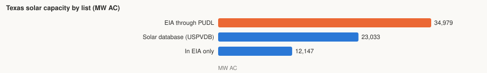

|  | Plants | MW AC |
| --- | --- | --- |
| EIA through PUDL | 251 | 34,979 |
| Solar database | 187 | 23,033 |
| In both | 185 | 22,832 |

Is the difference newer plants or corrections? Both, mostly newer:

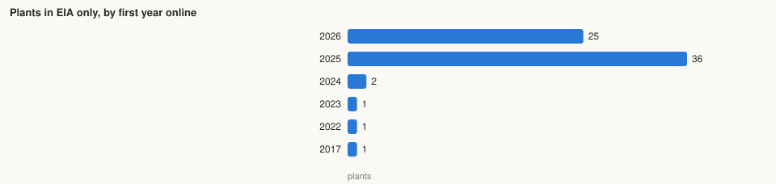

- Older plants missing from the solar database: GVEC (Guadalupe County, 2017, 2 MW); Samson Solar Energy (Franklin County, 2022, 250 MW); EDFR Bluebonnet (McLennan County, 2023, 9.9 MW); Delilah Solar Energy LLC (Red River County, 2024, 300 MW); Lumina II Solar Project (Scurry County, 2024, 326.6 MW).
- Among matched plants, capacity differs by more than 5% for 3 of 185; the first year differs for 8, by more than one year for 3 (Fighting Jays Solar Project: EIA 2022, solar database 2016; Emerald Grove: EIA 2023, solar database 2019; Samson Solar Energy III LLC: EIA 2022, solar database 2020).
- In the solar database only: E-Volve Energy Holdings, LLC (1.6 MW); Blue Jay Solar I, LLC (210 MW).

## 2. Which coordinates

**Chosen: the solar database's position where a plant has one (checked against imagery), EIA's otherwise.** The source used is stored per plant (`location_source`) and shown in the explorer panel.

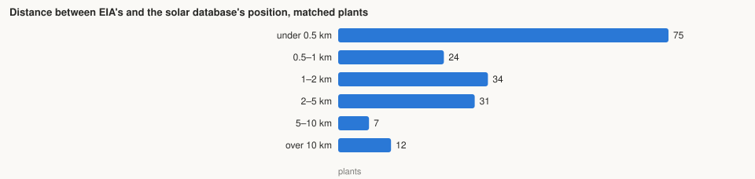

Median 0.86 km; 19 of 183 plants differ by more than 5 km, the largest by 94 km. The hail circle is tens of kilometres wide, so most differences do not matter, but the largest do. Positions in use: 65 from EIA, 185 from USPVDB (imagery-verified).

## 3. Borders, plant size and reporting bias: the steps so far

Annual chance that hail of 2 inches or more hits a plant, across the plants, as each decision was added. **In use: the fourth line as the uncorrected figure and the fifth as the corrected one; both are kept in the plant table.**

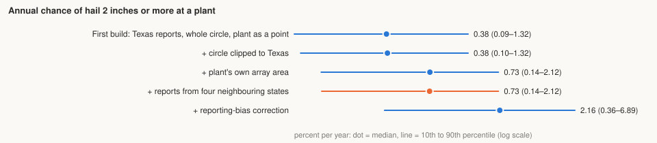

| Step | 10th percentile | Median | 90th percentile | Fighting Jays |
| --- | --- | --- | --- | --- |
| First build: Texas reports, whole circle, plant as a point | 0.09% | 0.38% | 1.32% | 0.15% |
| + circle clipped to Texas | 0.10% | 0.38% | 1.32% | 0.15% |
| + plant's own array area | 0.14% | 0.73% | 2.12% | 0.37% |
| + reports from four neighbouring states | 0.14% | 0.73% | 2.12% | 0.37% |
| + reporting-bias correction | 0.36% | 2.16% | 6.89% | 0.71% |

- **Clipping** matters only near Mexico and the Gulf: without it a border plant's reports are spread over land that can hold none.
- **Plant area** is the largest geometric change: a plant of several km² is a much bigger target than a point.
- **Neighbouring states** change plants near the state line; elsewhere nothing.
- **Bias correction** multiplies the rate by one over the fitted reporting rate around the plant (median 0.33 across plants).

## 4. Area of one hail event (the footprint)

**Chosen: 25 km² per report (Yuri, 2026-11-10).** A report is a point; this is the ground assumed hit. Published hailstreaks are mostly 10–21 km²; published radar swaths of severe hail are most often 50–100 km².

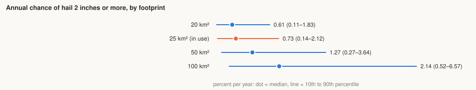

Measured from radar over Texas (connected areas at or above the threshold on one day, 2020–2025):

| Threshold | Swaths | 25th percentile km² | Median km² | 75th percentile km² | 90th percentile km² | Mean km² |
| --- | --- | --- | --- | --- | --- | --- |
| 30 mm | 18,844 | 8.1 | 16.0 | 43.6 | 122.7 | 59.1 |
| 50 mm | 4,477 | 7.7 | 14.6 | 33.9 | 76.6 | 34.8 |

25 km² lies between the measured median and mean.

## 5. How many reports, and the smallest circle

**Chosen: grow the circle to 100 reports, never under 10 km, never over 75 km.**

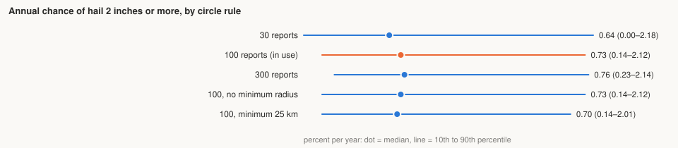

The count and the minimum radius move the median plant little. They matter in cities, where 100 reports sit within a few kilometres.

## 6. Correcting for where reports come from

**Chosen: keep both. The fitted correction (population and roads) is applied as a second set of columns, never replacing the first.** Radar (2020–2025) is the independent check: how many radar hail days (30 mm or more) per report-based hit (1 inch or more) at each plant. A ratio of 1 means agreement.

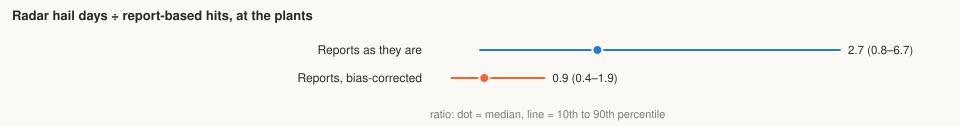

Uncorrected reports sit well below radar at the median plant; corrected reports sit close to it, without the correction having been tuned to radar. Radar over-calls, so a ratio somewhat above 1 would also be reasonable.

## 7. Radar threshold for a hail day

**Chosen: 30 mm of radar hail size (MESH), stated wherever it is used; 50 mm is shown beside it.** 30 mm is the best single discriminator of severe hail in the literature. Radar hail size is built to exceed most observed stones.

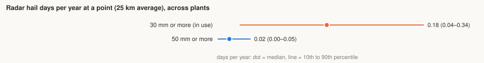

## 8. Four hail records for the same cells

Hail days per year in each Texas cell (about 253 km²), from each source. **No single source is chosen: they are shown side by side in the explorer.**

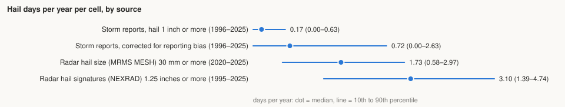

Reports need a person nearby; radar sees everywhere but over-calls; signatures come from single radars whose coverage and algorithm changed over the years.

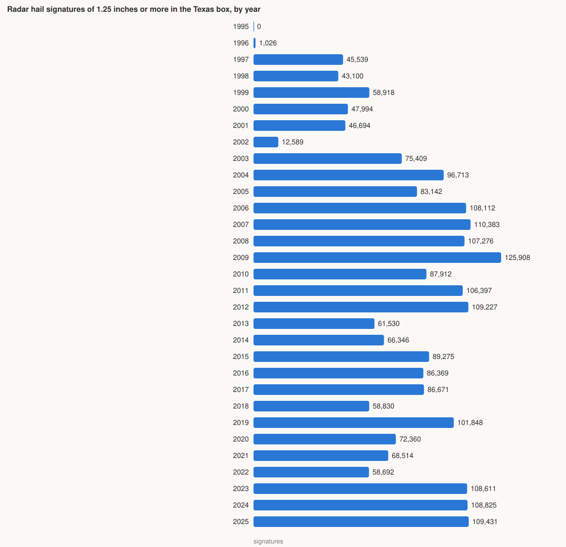

The year-to-year swing in signatures is partly weather and partly the record itself (missing values before the late 1990s, algorithm and network changes). It is a reason to treat the long record with care.

## 9. Hail curves per cell (Phase 3): pooling, window and family

**Chosen: pool each cell with its six neighbours, window 1996–2025, Gumbel with a zero atom.** 1-in-100-year hail size at ten city centres under each alternative:

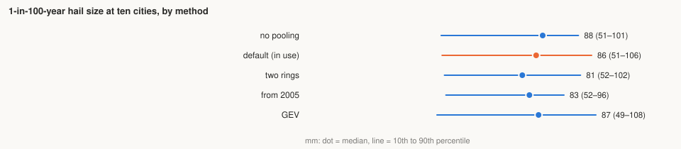

Pooling is the choice that matters; the family and the start year move values by a few millimetres. Details in `reports/3-curves-sensitivity.md`.

## Other decisions, without a chart

- **Several hail events in one year at one plant:** damage ratios are added and capped at 1 (2026-11-10).
- **Cells:** every H3 resolution-5 cell that intersects Texas, not only those whose centre is inside.
- **Curves in the browser:** evaluated by crc-sdk in Python at fixed return periods; the page never re-implements a curve.
- **Replacement value:** AC capacity times one recent benchmark cost per kW for every plant, since replacement is today's cost.
- **Storm Events source:** NCEI direct, not the Source Cooperative copy, which lags and stores local time without an offset.
- **Curve data and code** stay in this repo, written so they can be offered to crc-sdk.
