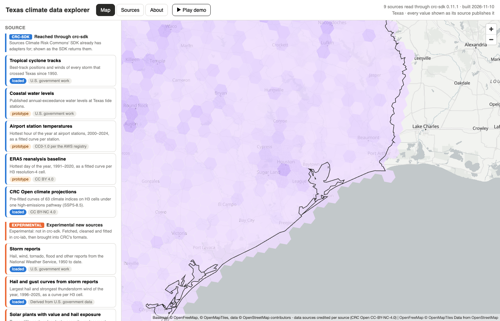
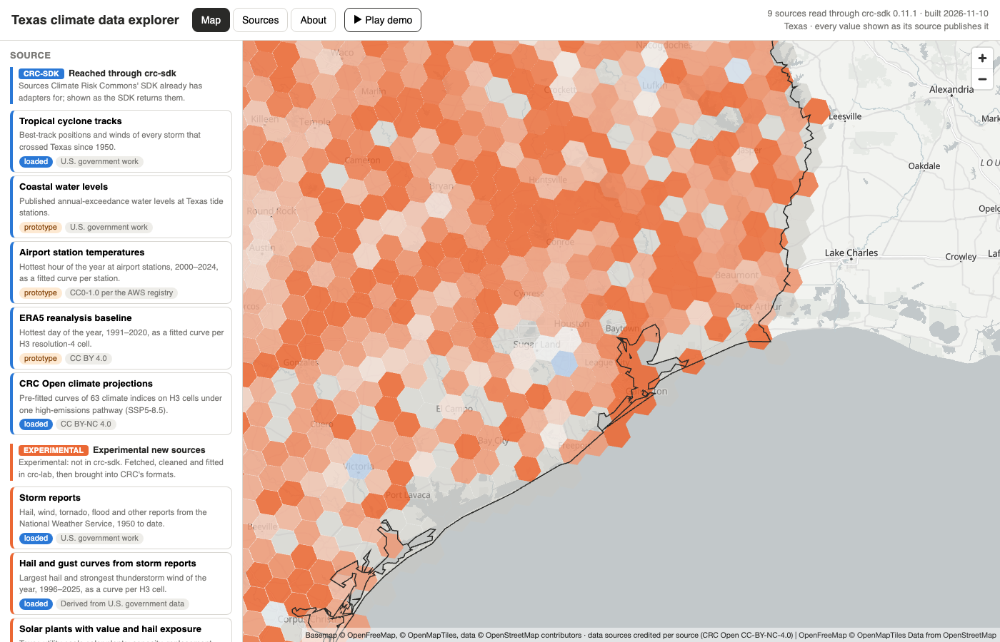

# Open questions for review

Written 2026-11-10 for Yuri to answer later. Nothing here blocks current work: each question says what is
done today, so "no answer" means "leave it as it is". Write the answer under each question, or just tell
Claude the question number and the letter.

| # | Question | What happens until you answer |
| --- | --- | --- |
| 1 | Comparison map: one colour scale for all sources, or one per source? | One shared scale |
| 2 | Comparison map: which two sources should the ratio view open on? | Reports and radar, in that order |
| 3 | Should the 30-second demo show the comparison map? | It does not |
| 4 | Radar hail-day threshold: 30 mm or 33 mm? | 30 mm |
| 5 | Should the reporting-bias correction have an upper limit? | No limit (up to 13 times) |
| 6 | Bias correction at a plant: per cell, or the smoother regional value? | Per cell |
| 7 | Solar loss: are plants built before 2021 really the stronger glass type? | Yes, by the spec's rule |
| 8 | Solar loss: what to do with thin-film plants? | Treated like the others, marked |
| 9 | What comes after Phase 5: loss from radar, or buildings? | Nothing started |
| 10 | Five older questions about the storm player | Unchanged |

## Background for questions 1 to 3

The explorer has a source called **"Hail days: sources compared"**. It colours each of the 2,566 Texas cells
(about 253 km² each) by **hail days per year**: how many days a year hail was recorded in that cell. Four
records can be shown, and they give very different numbers for the same thing:

| Record | Years | Hail days per year in the median cell | Highest cell |
| --- | --- | --- | --- |
| Storm reports, 1 inch or more | 1996–2025 | 0.17 | 3.1 |
| Storm reports, corrected for reporting bias | 1996–2025 | 0.72 | 12.0 |
| Radar hail size, 30 mm or more (MRMS) | 2020–2025 | 1.73 | 17.1 |
| Radar hail signatures, 1.25 inches or more (NEXRAD) | 1995–2025 | 3.10 | 6.5 |

So radar sees roughly ten times more hail days than people report. That gap is the reason the three questions
exist: any way of drawing the four on one map has to decide what to do about it.

## 1. One colour scale for all four sources, or one per source?

**What the scale does.** The map runs from pale (few hail days) to dark (many). The scale decides which number
is "dark".

**Today: one shared scale.** Dark means the same number of hail days whichever source is shown. Because radar
values are ten times larger, the storm-report map comes out almost blank:

This picture is true (reports really are that sparse beside radar), but you cannot see where in Texas the
reports are concentrated. A checkbox, "scale each source to its own range", fixes that: each source then uses
the full range from pale to dark. The cost is that the same colour now means different numbers in different
sources, so two maps can no longer be compared by eye.

**The choice.**

- **A. Keep the shared scale as the default** (today). Good for "how do the sources differ in level"; poor for
  "where does each source see hail".
- **B. Make own-range the default.** The opposite trade.
- **C. Own-range when looking at one source; shared scale in the swipe view.** In the swipe view two sources
  sit side by side on one map, and there a shared scale is the only honest option.

**Suggested: C.** It matches what each view is for. About an hour of work.

Your answer:

## 2. Which two sources should the ratio view open on?

**What the ratio view does.** It divides one source by another, cell by cell, and colours the result: one
colour where the first source has more hail days, another where the second has more, grey where they agree.

**Today.** The view uses whichever two sources are selected in the two drop-downs. On first opening that is
storm reports and radar. Nothing steers the reader to the most useful pair.

**The choice.** Which pair should the view start on?

- **A. Radar ÷ storm reports.** Shows where reports under-count most. Expect strong colour in empty country and
  grey near cities. This is the main finding of the hail work so far.
- **B. Radar ÷ bias-corrected reports.** Shows whether the correction works. If it does, the map is mostly
  grey; coloured patches are where the correction fails.
- **C. Leave it** to the drop-downs.

**Suggested: A as the opening pair, with B one click away** as a named button ("Does the correction work?").

Your answer:

## 3. Should the 30-second demo show the comparison map?

**What the demo is.** The "Play demo" button runs an automatic tour of eight steps, among them storm tracks, one
hurricane with its wind field, the storm player, storm reports in a time window, a curve layer, the CRC Open
projections and the Sources tab. It is also the recorded video on the About page.

**Today.** The comparison map is not in the tour. The tour already runs 31.6 seconds against a 30-second
target, so adding a step means removing or shortening another.

**The choice.**

- **A. Leave the demo alone.**
- **B. Replace the CRC Open step.** You have said CRC Open is one source among many, not the main one.
- **C. Replace the Sources tab step,** the least visual step.
- **D. Lengthen the demo to about 40 seconds** and keep everything.

**Suggested: B, done at the next re-recording** (you asked for the video to be re-recorded after each major
release; Phase 5 could count as one).

Your answer:

## 4. Radar hail-day threshold: 30 mm or 33 mm?

A "radar hail day" is a day when the radar-estimated hail size over a place reaches a threshold. You wrote
"let's keep 33 mm". The code had 30 mm at the time, so this was read as a typing slip and 30 mm was kept;
50 mm is shown beside it.

If you did mean 33 mm, say so. It is a one-line change and a rebuild of the radar tables (minutes, from the
cached radar files). Radar hail days would fall somewhat, since fewer days reach the higher threshold; the
effect has not been measured.

Your answer:

## 5. Should the reporting-bias correction have an upper limit?

**What the correction does.** Reports are sparse where few people live. The bias model estimates, for each
cell, the share of hail days that get reported (the "reporting rate"), from population and roads. The corrected
hail rate is the reported rate divided by that share.

**The problem.** In a cell with no people and no main road the fitted reporting rate is about 6%, so the
correction multiplies by about 17. That 6% is the least certain number in the model, and it now feeds the
loss figures: in Phase 5 the correction multiplies a plant's hail loss by 3.0 at the median and by up to 13.2,
and 50 of the 250 plants get a factor above 5.

**The choice.**

- **A. No limit** (today). Faithful to the model; the largest losses rest on its weakest number.
- **B. Limit the factor,** for example to 5, until radar can check it. Simple, but the limit itself would be a
  number with no source.
- **C. No limit, but flag** plants whose factor is above 5 in the explorer and the reports.

**Suggested: C.** It hides nothing and adds no invented number. Radar gives some support to the uncapped
correction: at the median plant, radar hail days ÷ corrected reports is 0.9.

Your answer:

## 6. Bias correction at a plant: per cell, or the smoother regional value?

The bias model produces two things. One is a reporting rate **per cell** (253 km²), which the plant figures use
today: the reports around a plant are scaled up by the reporting rates of the cells in its circle. The other is
a "true" hail rate **per region** (73 regions of about 12,000 km²), which is smoother and more stable but blurs
real differences inside a region.

- **A. Per cell** (today): keeps local detail, noisier.
- **B. Regional**: steadier, but every plant in a region gets nearly the same hail rate.

**Suggested: A for now,** and revisit when radar and reports are combined in one model.

Your answer:

## 7. Solar loss: are plants built before 2021 really the stronger glass type?

The damage curve needs to know each plant's module glass. No data source lists it, so the spec gives a rule:
plants first online in 2021 or later have thin 2.0 mm glass on both sides; older plants have 3.2 mm glass with
a backsheet. The older type breaks far less in the lab (at 2-inch hail, 41% of modules against 90%).

The effect is large. If every plant had the newer glass, the portfolio loss would be 13% higher; if every
plant had the older glass, it would be 69% lower. So the year rule decides a great deal, and 2021 is "about
2021" in the spec.

- **A. Keep the rule** (today).
- **B. Report every plant both ways** as a range.
- **C. Find real module data** for the largest plants (a research task).

Your answer:

## 8. Solar loss: what to do with thin-film plants?

47 plants use thin-film modules (mostly First Solar). The spec's two breakage tables are for crystalline
silicon modules; there is none for thin film. Today these plants follow the year rule like the rest and carry
a note.

- **A. Leave as is** (today).
- **B. Report them separately,** so the total for the other plants is not mixed with a guess.
- **C. Research a thin-film breakage table** and add it to the spec.

Your answer:

## 9. What comes after Phase 5?

Two candidates, both sizeable:

- **A. Loss from radar hail.** Radar sees the hail that reports miss (105 mm over Fighting Jays on 16 March
  2024, where reports give that plant a small loss). But the spec says radar size and observed size must not be
  mixed, and v0 has no solar curve keyed to radar size. It needs your decision on how to feed radar size in.
- **B. A building asset set,** starting with Fort Bend County, so the two building curves have something to
  run on. Today they are only shown at ten city centres.

Your answer:

## 10. Five older questions about the storm player

These were set aside on 2026-11-10 and are listed in
[the E4 report](reports/E4-groups-about-demo.md#next-iteration-deferred-by-yuri-2026-11-10). In short: should
reports fade after a while; should storm mode show only reports near the track; how long the player window
should be; whether to draw a storm's outer size when wind radii are missing; and whether the larger events
file (5.3 MB) is acceptable. They are folded into the [explorer plan](plan-explorer-next.md).
