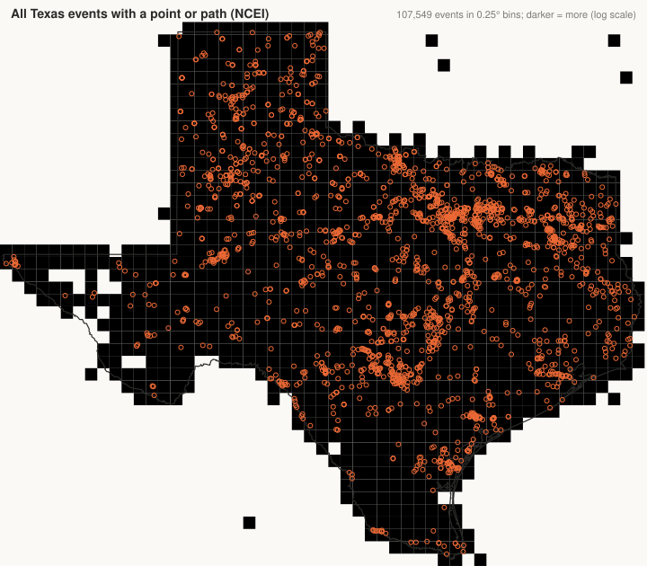
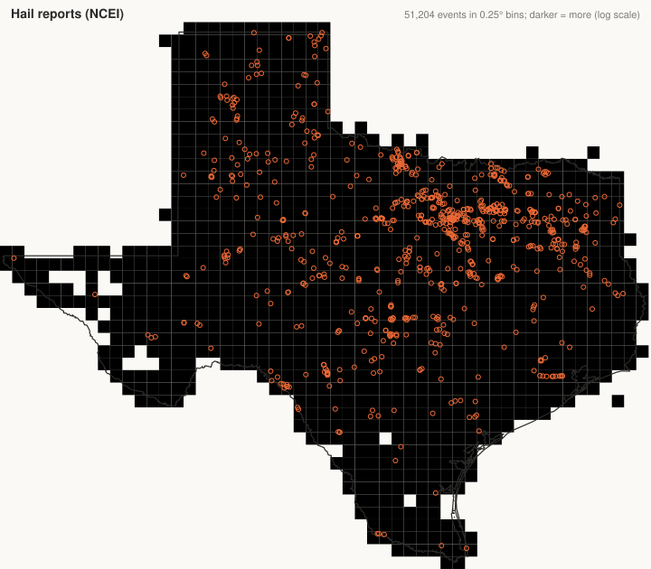
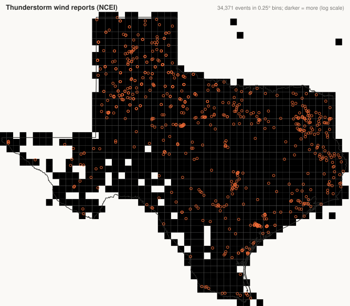

# Phase 2 report: Storm Events two-source comparison, Texas

NCEI snapshot retrieved 2026-11-10T17:45:08+00:00; Source Cooperative copy `events.parquet` (Last-Modified Mon, 17 Aug 2026 22:12:03 GMT, SHA-256 `ddbca4d3ac4af126…`, 197 MB). Matching on NOAA's `event_id`. State filter: `TEXAS` in both.

## 1. Event counts

By year (NCEI direct, copy, difference):

| year | ncei | copy_count | difference |
| --- | --- | --- | --- |
| 1950 | 20 | 20 | 0 |
| 1951 | 15 | 15 | 0 |
| 1952 | 13 | 13 | 0 |
| 1953 | 33 | 33 | 0 |
| 1954 | 84 | 84 | 0 |
| 1955 | 241 | 241 | 0 |
| 1956 | 170 | 170 | 0 |
| 1957 | 346 | 346 | 0 |
| 1958 | 288 | 288 | 0 |
| 1959 | 249 | 249 | 0 |
| 1960 | 224 | 224 | 0 |
| 1961 | 354 | 354 | 0 |
| 1962 | 375 | 375 | 0 |
| 1963 | 260 | 260 | 0 |
| 1964 | 256 | 256 | 0 |
| 1965 | 335 | 335 | 0 |
| 1966 | 279 | 279 | 0 |
| 1967 | 403 | 403 | 0 |
| 1968 | 469 | 469 | 0 |
| 1969 | 410 | 410 | 0 |
| 1970 | 325 | 325 | 0 |
| 1971 | 483 | 483 | 0 |
| 1972 | 399 | 399 | 0 |
| 1973 | 503 | 503 | 0 |
| 1974 | 424 | 424 | 0 |
| 1975 | 497 | 497 | 0 |
| 1976 | 585 | 585 | 0 |
| 1977 | 379 | 379 | 0 |
| 1978 | 496 | 496 | 0 |
| 1979 | 726 | 726 | 0 |
| 1980 | 772 | 772 | 0 |
| 1981 | 768 | 768 | 0 |
| 1982 | 956 | 956 | 0 |
| 1983 | 944 | 944 | 0 |
| 1984 | 721 | 721 | 0 |
| 1985 | 886 | 886 | 0 |
| 1986 | 1,018 | 1,018 | 0 |
| 1987 | 892 | 892 | 0 |
| 1988 | 766 | 766 | 0 |
| 1989 | 1,626 | 1,626 | 0 |
| 1990 | 1,395 | 1,395 | 0 |
| 1991 | 1,615 | 1,615 | 0 |
| 1992 | 2,087 | 2,087 | 0 |
| 1993 | 1,719 | 1,719 | 0 |
| 1994 | 2,544 | 2,544 | 0 |
| 1995 | 2,947 | 2,947 | 0 |
| 1996 | 3,966 | 3,966 | 0 |
| 1997 | 4,001 | 4,001 | 0 |
| 1998 | 4,092 | 4,092 | 0 |
| 1999 | 3,140 | 3,140 | 0 |
| 2000 | 4,288 | 4,288 | 0 |
| 2001 | 3,488 | 3,488 | 0 |
| 2002 | 3,600 | 3,600 | 0 |
| 2003 | 3,224 | 3,224 | 0 |
| 2004 | 3,977 | 3,977 | 0 |
| 2005 | 3,370 | 3,370 | 0 |
| 2006 | 3,812 | 3,812 | 0 |
| 2007 | 4,701 | 4,701 | 0 |
| 2008 | 3,718 | 3,718 | 0 |
| 2009 | 5,051 | 5,051 | 0 |
| 2010 | 2,950 | 2,950 | 0 |
| 2011 | 5,582 | 5,582 | 0 |
| 2012 | 4,814 | 4,814 | 0 |
| 2013 | 5,269 | 5,269 | 0 |
| 2014 | 4,708 | 4,708 | 0 |
| 2015 | 5,278 | 5,278 | 0 |
| 2016 | 3,474 | 3,474 | 0 |
| 2017 | 3,621 | 3,621 | 0 |
| 2018 | 3,405 | 3,405 | 0 |
| 2019 | 4,358 | 4,358 | 0 |
| 2020 | 4,128 | 4,128 | 0 |
| 2021 | 4,623 | 4,623 | 0 |
| 2022 | 5,414 | 5,414 | 0 |
| 2023 | 7,689 | 7,689 | 0 |
| 2024 | 5,678 | 5,678 | 0 |
| 2025 | 5,641 | 5,641 | 0 |
| 2026 | 3,857 | 592 | 3,265 |

By event type (NCEI name against the copy's slug):

| type_name | ncei | copy_count |
| --- | --- | --- |
| Hail | 55,572 | 54,807 |
| Thunderstorm Wind | 37,058 | 36,302 |
| Drought | 18,626 | 17,993 |
| Flash Flood | 14,026 | 13,531 |
| Tornado | 10,095 | 10,051 |
| High Wind | 5,951 | 5,782 |
| Heat | 4,871 | 4,671 |
| Winter Weather | 3,139 | 3,139 |
| Winter Storm | 2,230 | 2,230 |
| Excessive Heat | 1,956 | 1,879 |
| Flood | 1,854 | 1,821 |
| Wildfire | 1,492 | 1,452 |
| Heavy Snow | 1,465 | 1,465 |
| Cold/Wind Chill | 1,083 | 1,079 |
| Lightning | 1,001 | 995 |
| Ice Storm | 936 | 936 |
| Heavy Rain | 844 | 841 |
| Frost/Freeze | 800 | 800 |
| Funnel Cloud | 730 | 725 |
| Extreme Cold/Wind Chill | 457 | 457 |
| Strong Wind | 343 | 320 |
| Tropical Storm | 322 | 319 |
| Dust Storm | 276 | 273 |
| Dense Fog | 224 | 224 |
| Blizzard | 165 | 165 |
| Storm Surge/Tide | 134 | 134 |
| Coastal Flood | 112 | 112 |
| Hurricane (Typhoon) | 85 | 0 |
| Astronomical Low Tide | 83 | 77 |
| Rip Current | 74 | 74 |
| Sleet | 70 | 70 |
| Freezing Fog | 55 | 55 |
| Tropical Depression | 35 | 35 |
| Waterspout | 22 | 22 |
| High Surf | 13 | 13 |
| Dust Devil | 9 | 9 |
| Debris Flow | 3 | 3 |
| Sneakerwave | 1 | 1 |
| Dense Smoke | 1 | 1 |
| Seiche | 1 | 1 |
| hurricane | 0 | 85 |

## 2. Present in one, missing in the other

| ncei_events | copy_events | matched_events | only_ncei | only_copy |
| --- | --- | --- | --- | --- |
| 166,214 | 162,949 | 162,949 | 3,265 | 0 |

Only in NCEI, by year and type:

| year | event_type | events |
| --- | --- | --- |
| 2026 | Astronomical Low Tide | 6 |
| 2026 | Cold/Wind Chill | 4 |
| 2026 | Drought | 633 |
| 2026 | Dust Storm | 3 |
| 2026 | Excessive Heat | 77 |
| 2026 | Flash Flood | 495 |
| 2026 | Flood | 33 |
| 2026 | Funnel Cloud | 5 |
| 2026 | Hail | 765 |
| 2026 | Heat | 200 |
| 2026 | Heavy Rain | 3 |
| 2026 | High Wind | 169 |
| 2026 | Lightning | 6 |
| 2026 | Strong Wind | 23 |
| 2026 | Thunderstorm Wind | 756 |
| 2026 | Tornado | 44 |
| 2026 | Tropical Storm | 3 |
| 2026 | Wildfire | 40 |

Only in the copy, by year and type:

_no rows_

## 3. Matched events: location

Distance between NCEI's first point and the copy's point, by how NCEI located the event (`path`/`point` have coordinates; `county`/`zone` do not, so the copy's point there is a centroid):

| geometry_kind | events | copy_no_geometry | same_point | median_km | max_km |
| --- | --- | --- | --- | --- | --- |
| point | 90,296 | 0 | 90,296 | 0 | 0 |
| zone | 42,908 | 0 | 0 | – | – |
| path | 15,146 | 0 | 15,146 | 0 | 0 |
| county | 12,897 | 0 | 0 | – | – |
| none | 1,702 | 1,044 | 0 | – | – |

| matched_events | ncei_without_point | copy_gave_a_point_for_these | share_percent | copy_point_inside_ncei_polygon | copy_point_outside_ncei_polygon |
| --- | --- | --- | --- | --- | --- |
| 162,949 | 55,805 | 55,805 | 34.2 | 55,805 | 0 |

## 4. Magnitude and magnitude type (hail, thunderstorm wind)

The copy stores magnitude as float32, so values are compared to 0.001:

| event_type | matched_events | ncei_has_magnitude | copy_has_magnitude | equal_magnitude | ncei_has_type | copy_has_type | equal_type |
| --- | --- | --- | --- | --- | --- | --- | --- |
| Hail | 54,807 | 54,801 | 54,801 | 54,801 | 5 | 5 | 5 |
| Thunderstorm Wind | 36,302 | 33,335 | 33,335 | 33,335 | 21,240 | 21,240 | 21,240 |

Largest disagreements in magnitude among matched hail and wind events:

_no rows_

## 5. Damage fields

NCEI strings parsed here as number × K/M/B; the copy ships integers (null NCEI strings appear as 0 in the copy):

| ncei_parse | events | copy_not_null | equal | ncei_null_copy_zero | different |
| --- | --- | --- | --- | --- | --- |
| ok | 126,366 | 126,366 | 126,366 | 0 | 0 |
| empty | 36,583 | 36,583 | 0 | 36,583 | 0 |

Largest disagreements among matched, parsed values:

_no rows_

## 6. County code against coordinates

County-located events whose NCEI point falls outside that county's Census polygon:

| county_events_with_points | county_polygon_missing | point_outside_its_county | percent_outside |
| --- | --- | --- | --- |
| 107,515 | 95 | 5,486 | 5.1 |

What the copy did with those events:

| conflicting_events | copy_dropped_geometry | copy_kept_ncei_point | copy_moved_point |
| --- | --- | --- | --- |
| 5,486 | 30 | 5,456 | 0 |

| event_id | year | event_type | cz_name | lon | lat |
| --- | --- | --- | --- | --- | --- |
| 1326089 | 2026 | Hail | FANNIN | -96.413 | 33.511 |
| 1326138 | 2026 | Hail | ROCKWALL | -96.57 | 32.9 |
| 1327174 | 2026 | Hail | BREWSTER | -102.618 | 30.605 |
| 1327400 | 2026 | Hail | MIDLAND | -102.07 | 32.09 |
| 1332383 | 2026 | Hail | CASS | -94.04 | 33.02 |
| 1333749 | 2026 | Hail | REAL | -100.01 | 29.63 |
| 1333778 | 2026 | Hail | EDWARDS | -100.01 | 29.64 |
| 1334938 | 2026 | Hail | DALLAS | -96.88 | 32.99 |

## 7. Latest date covered

| ncei_latest_begin_utc | copy_latest_begin_ts | ncei_latest_year | copy_latest_year |
| --- | --- | --- | --- |
| 2026-08-01 04:51:00 | 2026-01-31 05:15:00 | 2026 | 2026 |

## Time convention

Whether the copy's `begin_ts` equals NCEI's local standard time (as printed in the file) or UTC:

| matched_events | copy_equals_ncei_local | copy_equals_utc |
| --- | --- | --- |
| 162,949 | 162,949 | 0 |

## Maps

**All Texas events with a point or path (NCEI)** — 107,549 events; orange rings mark the 2,107 not in the copy.

**Hail reports (NCEI)** — 51,204 events; orange rings mark the 765 not in the copy.

**Thunderstorm wind reports (NCEI)** — 34,371 events; orange rings mark the 756 not in the copy.

## Conclusion

- **Same events.** 162,949 of 166,214 NCEI Texas events are in the copy by `event_id`; nothing is in the copy only. The 3,265 NCEI-only events are all in 2026: the copy lags (latest `begin_ts` 2026-01-31 05:15:00, NCEI 2026-08-01 04:51:00 UTC).
- **Same points where NCEI has them.** 105,442 of 105,442 located events carry the identical first coordinate in the copy (paths keep only their first point). For the 55,805 county- and zone-located events (34.2% of matched) the copy supplies a centroid, which lies inside the NCEI polygon in 55,805 cases; those points are areas, not places.
- **Magnitudes agree.** Hail: 54,801 of 54,801 equal; thunderstorm wind: 33,335 of 33,335, with `magnitude_type` present and equal for 21,240 wind events (NCEI itself has no type for the rest). The copy stores magnitude as float32.
- **Damage parsed the same way.** 126,366 parsed values equal to the dollar; the 36,583 empty NCEI strings are 0 in the copy, so the copy cannot distinguish 'no damage' from 'not reported'.
- **Times are local standard time, not UTC.** The copy's `begin_ts` equals NCEI's printed local time for 162,949 of 162,949 events and UTC for 0; it carries no offset. This table converts with `CZ_TIMEZONE`.
- **County code against coordinates.** 5,486 of 107,515 county-located events (5.1%) have a point outside that county's Census polygon; the copy kept the NCEI point for 5,456, dropped geometry for 30, moved none. Neither source resolves them.
- **Naming.** Type slugs differ from NCEI names only for Hurricane (Typhoon), hurricane.

**What the copy can be used for:** quick maps and counts of events up to its cutoff, with the same magnitudes and damage as NCEI. **What it cannot be used for:** UTC-aware timing, paths and multi-point events, telling unreported from zero damage, anything after its last monthly update, and any county/zone event as a precise location. This project therefore builds from NCEI direct and keeps the copy as a cross-check.
