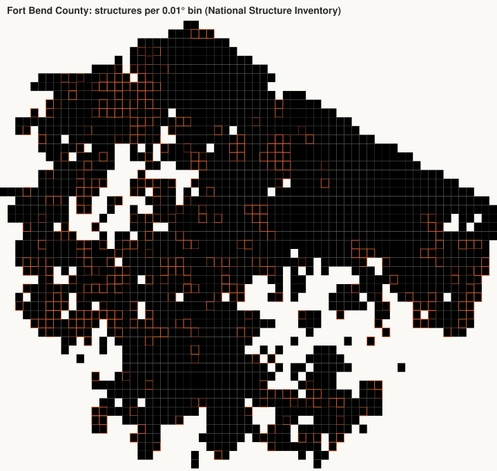

# Phase 4 note: two federal building sources in Fort Bend County (A2)

County FIPS 48157. National Structure Inventory (NSI, US Army Corps, API) against USA Structures (FEMA / Oak
Ridge, GeoParquet copy on Source Cooperative). Every number is computed by `python -m crc_lab.assets.real_estate`.

## Counts

| | NSI | USA Structures |
| --- | --- | --- |
| Records | 305,551 points | 265,565 footprints |
| Structure value | $187.6 billion (contents $113.5 billion) | not provided |
| Footprint area | not provided as geometry | 78.3 km² |

NSI by damage category (count, structure value in $ billion):

| Category | Count | Value |
| --- | --- | --- |
| RES | 282495 | 153.47 |
| COM | 17696 | 21.08 |
| PUB | 4216 | 10.2 |
| IND | 1144 | 2.85 |

NSI building type (W wood, M masonry, S steel, H manufactured, C concrete):

| Type | Count |
| --- | --- |
| W | 217898 |
| M | 73749 |
| S | 6233 |
| H | 4020 |
| C | 3651 |

USA Structures occupancy class:

| Class | Count |
| --- | --- |
| Residential | 246827 |
| Commercial | 8854 |
| Agriculture | 3276 |
| Unclassified | 2498 |
| Government | 2298 |
| Education | 1102 |
| Industrial | 403 |
| Assembly | 265 |
| Utility and Misc | 42 |

Where NSI says its own footprint came from:

| Source | Count |
| --- | --- |
| Bing | 287198 |
| ORNL | 10704 |
| P | 6555 |
| NGA | 1093 |
| H | 1 |

## Point-to-footprint join

| Measure | Value |
| --- | --- |
| NSI points inside a USA Structures footprint | 242,785 (79.5%) |
| Share of NSI structure value on joined points | 80.3% |
| NSI points inside more than one footprint | 6 |
| Footprints holding at least one NSI point | 226,722 (85.4%) |
| Footprints holding several NSI points | 11,200 |

## Occupancy agreement on joined pairs

233,574 of 242,791 joined pairs agree (96.2%) under this mapping: {"RES": ["Residential"], "COM": ["Assembly", "Commercial"], "IND": ["Agriculture", "Industrial", "Utility and Misc"], "PUB": ["Assembly", "Education", "Government"]}.

| NSI category | USA Structures class | Pairs |
| --- | --- | --- |
| COM | Commercial | 7318 |
| COM | Residential | 2355 |
| COM | Agriculture | 1594 |
| COM | Education | 335 |
| COM | Unclassified | 170 |
| COM | Government | 119 |
| COM | Industrial | 32 |
| COM | Utility and Misc | 23 |
| COM | Assembly | 21 |
| IND | Commercial | 647 |
| IND | Industrial | 164 |
| IND | Residential | 84 |
| IND | Education | 34 |
| IND | Utility and Misc | 20 |
| IND | Government | 12 |
| IND | Unclassified | 5 |
| IND | Agriculture | 4 |
| IND | Assembly | 3 |
| PUB | Government | 1158 |
| PUB | Education | 767 |
| PUB | Commercial | 640 |
| PUB | Residential | 298 |
| PUB | Assembly | 192 |
| PUB | Industrial | 19 |
| PUB | Agriculture | 10 |
| PUB | Utility and Misc | 8 |
| PUB | Unclassified | 7 |
| RES | Residential | 223930 |
| RES | Unclassified | 1700 |
| RES | Commercial | 824 |
| RES | Agriculture | 187 |
| RES | Government | 53 |
| RES | Education | 34 |
| RES | Industrial | 12 |
| RES | Assembly | 11 |
| RES | Utility and Misc | 1 |

## Map

Darker bins hold more structures; an orange outline marks bins where fewer than half of the NSI points fall inside
a USA Structures footprint.

