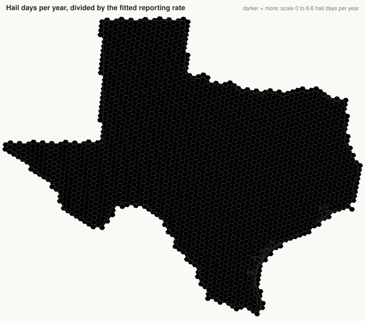

# Report 5: a first reporting-bias correction for hail reports

Built 2026-11-10 on branch `reporting-bias`; a first attempt at section 2 of `docs/plan-hail-exposure.md`, for review. Every number below is written by `just reporting-bias` (`python -m crc_lab.assets.reporting_bias`).

## What was built

- **Grid.** The 2,566 Texas H3 resolution-5 cells already used for the hazard layers and curves (about 253 km² each), so results line up with the rest of the project. A 10 km grid would be finer than most rural reporting.
- **Counts.** Hail days per cell, 1996–2025: a local calendar day with at least one located hail report touching the cell. 28,877 cell-days in all; 316 cells have none. The same for hail of 1 inch or more.
- **Population.** 2020 Census tract populations (6,884 tracts, 29,145,505 people) spread over cells by area of overlap; 29,145,505 people land in the cells.
- **Roads.** Census TIGER/Line 2024 primary and secondary roads, length inside each cell: 102,802 km in all.

| Input | File | SHA-256 | Retrieved |
| --- | --- | --- | --- |
| tracts | [cb_2020_48_tract_500k.zip](https://www2.census.gov/geo/tiger/GENZ2020/shp/cb_2020_48_tract_500k.zip) | `329384e89a98627e…` | 2026-11-10 |
| population | [CenPop2020_Mean_TR48.txt](https://www2.census.gov/geo/docs/reference/cenpop2020/tract/CenPop2020_Mean_TR48.txt) | `663d9ea530afd040…` | 2026-11-10 |
| roads | [tl_2024_48_prisecroads.zip](https://www2.census.gov/geo/tiger/TIGER2024/PRISECROADS/tl_2024_48_prisecroads.zip) | `4ca11d057b55b294…` | 2026-11-10 |

All three are U.S. Census Bureau files, public domain. The Census API for the decennial count needs a key, so tract populations come from the Bureau's centers-of-population file instead. No raster population product is used (rasterio does not load on this machine).

## Model

    hail days in cell i ~ Poisson(years × true_rate[region of i] × reporting_rate_i)
    reporting_rate_i = floor + (1 − floor) × (1 − exp(−(b_pop × people per km² + b_road × road km per km²)))

The form follows Potvin et al. (2019) for tornadoes, written so the rate rises toward 1; their paper was not re-read here and none of their parameters is used. The true rate is one value per H3 resolution-3 region (73 regions, about 12,000 km² each) and has a closed-form best value given the reporting rates, so only the floor and the two slopes are searched.

**Identifying assumption.** Inside one region, hail climate is the same in every cell. Any difference between cells of a region that lines up with people or roads is therefore counted as reporting. Nothing else separates true rate from reporting rate, and the densest cells are assumed to report every hail day.

## Estimates

| Model | floor | b_pop (per person/km²) | b_road (per km/km²) | Held-out log-likelihood per cell |
| --- | --- | --- | --- | --- |
| none | 1.000 | 0.0000 | 0.000 | 17.926 |
| population | 0.125 | 0.0220 | 0.000 | 19.419 |
| roads | 0.067 | 0.0000 | 1.143 | 19.874 |
| both (chosen) | 0.059 | 0.0104 | 1.214 | 20.100 |

Five-fold held-out likelihood prefers **both**. Bootstrap over cells (200 resamples), 5th to 95th percentile: floor 0.051–0.068, b_pop 0.0068–0.0139, b_road 1.05–1.38.

Counts are more variable than Poisson: the dispersion statistic is 4.0, so these intervals are too narrow. For hail of 1 inch or more the same model gives floor 0.064, b_pop 0.0106, b_road 1.224.

Fitted reporting rate across cells: minimum 0.059, 10th percentile 0.064, median 0.191, 90th percentile 0.622, maximum 1.000. Correction factor (1 ÷ reporting rate): median 5.2 over all cells, 1.11 in the densest tenth, **15.0 in the sparsest quarter**.

## Before and after

Hail days per year in the cell holding each city centre:

| City | People per km² | Road km per km² | Observed | Reporting rate | Corrected | Factor | Region true rate |
| --- | --- | --- | --- | --- | --- | --- | --- |
| Houston | 2,042 | 1.68 | 2.03 | 1.00 | 2.03 | 1.00 | 0.52 |
| Dallas | 1,285 | 1.69 | 0.67 | 1.00 | 0.67 | 1.00 | 1.38 |
| San Antonio | 1,269 | 1.60 | 1.57 | 1.00 | 1.57 | 1.00 | 0.87 |
| Austin | 1,471 | 1.32 | 1.70 | 1.00 | 1.70 | 1.00 | 0.72 |
| Fort Worth | 1,337 | 1.61 | 2.97 | 1.00 | 2.97 | 1.00 | 1.38 |
| El Paso | 90 | 0.44 | 0.17 | 0.78 | 0.21 | 1.28 | 0.32 |
| Amarillo | 597 | 1.46 | 4.57 | 1.00 | 4.57 | 1.00 | 3.83 |
| Lubbock | 265 | 1.28 | 2.57 | 0.99 | 2.60 | 1.01 | 2.71 |
| Corpus Christi | 233 | 0.35 | 0.47 | 0.95 | 0.49 | 1.06 | 0.51 |
| Midland | 440 | 1.03 | 2.43 | 1.00 | 2.44 | 1.00 | 2.23 |

Solar plants (250 from the current plant list): correction factor at the plant's cell, 10th percentile 1.1, **median 3.3**, 90th percentile 7.5.

Fort Bend County plants:

| Plant | People per km² | Road km per km² | Observed days/yr | Reporting rate (5–95%) | Corrected days/yr | Factor | Region true rate |
| --- | --- | --- | --- | --- | --- | --- | --- |
| Bronson | 45.7 | 0.495 | 0.13 | 0.680 (0.597–0.740) | 0.20 | 1.5 | 0.44 |
| Fighting Jays Solar Project | 47.3 | 0.162 | 0.40 | 0.528 (0.433–0.604) | 0.76 | 1.9 | 0.44 |
| Fort Bend Solar LLC | 45.7 | 0.495 | 0.13 | 0.680 (0.597–0.740) | 0.20 | 1.5 | 0.44 |
| Old 300 Solar Center, LLC | 15.3 | 0.062 | 0.10 | 0.256 (0.210–0.298) | 0.39 | 3.9 | 0.44 |
| Cutlass Solar II | 65.3 | 0.446 | 0.23 | 0.723 (0.631–0.787) | 0.32 | 1.4 | 0.52 |
| Cutlass Solar 1 LLC | 47.3 | 0.162 | 0.40 | 0.528 (0.433–0.604) | 0.76 | 1.9 | 0.44 |

For a single cell the corrected value is noisy (a small count divided by a small rate); the region true rate is the steadier number.

## Checks

**Against the published pattern** (SPC: most hail over the Panhandle and north Texas, least on the coast and far west). Mean hail days per year per cell:

| Area | People per km² | Observed | Corrected | Region true rate |
| --- | --- | --- | --- | --- |
| Panhandle | 6 | 0.63 | 3.48 | 3.36 |
| North Texas | 136 | 0.74 | 1.68 | 1.64 |
| Coast | 40 | 0.13 | 0.42 | 0.45 |
| Far west | 17 | 0.10 | 0.56 | 0.68 |

As observed: Panhandle 0.63, north Texas 0.74. After correction: Panhandle 3.48, north Texas 1.68; coast 0.42 and far west 0.56 stay lowest.

**Against radar** (MRMS daily-maximum hail size, 2021–2025; a radar hail day is any pixel in the cell at 29 mm or more; reports are days with hail of 1 inch or more in the same years; the correction uses the 1-inch fit). Mean days per year per cell:

| Cells | Count | Radar | Reported | Corrected | Radar ÷ reported | Radar ÷ corrected | Fitted factor, median |
| --- | --- | --- | --- | --- | --- | --- | --- |
| densest tenth of cells | 257 | 1.72 | 0.85 | 0.97 | 2.0 | 1.76 | 1.1 |
| middle | 1,667 | 2.00 | 0.30 | 1.27 | 6.7 | 1.58 | 4.6 |
| sparsest quarter of cells | 642 | 2.06 | 0.11 | 0.82 | 17.9 | 2.52 | 14.0 |
| all cells | 2,566 | 1.98 | 0.31 | 1.12 | 6.4 | 1.77 | 5.1 |

Correlation across cells with radar: reported 0.20, corrected 0.29. Radar by area: Panhandle 2.82, North Texas 2.15, Coast 1.54, Far west 0.95.

Read with care: a radar pixel at 29 mm is not a confirmed 1-inch stone on the ground (radar over-calls), and the radar day is a 24-hour window ending at a fixed hour, not the local calendar day.

**Against Wendt and Jirak (2021)**, who found radar severe-hail hours 2 to 4 times Storm Data in the populated plains, more where few people live: the radar table above is this project's own ratio. Their figure is on an 80 km grid, where one report anywhere confirms the box; these cells are about 16 km across, so larger factors are expected and the two are not directly comparable. Nothing was tuned toward either number.

## Maps

## Limits

- True rate and reporting rate are separated only by the assumption that hail climate is flat inside a region. Real gradients inside a region are read as reporting.
- The densest cells are assumed to report every hail day. If they miss some, every corrected rate is too low by the same factor.
- The floor is the reporting rate of a cell with no people and no primary road. It carries the largest corrections.
- Poisson intervals are too narrow given the overdispersion; a negative binomial fit is the next step.
- No era term: reporting practice changed over the window and population is a 2020 snapshot.
- Reports from neighbouring states are not used here.
- This corrects hail-day frequency, not reported size.

## Questions for Yuri

1. Use the per-cell corrected rate, or the smoother region true rate, when this feeds the plant exposure?
2. Should the factor in empty cells be capped until radar calibrates it?
3. Add an era term and a negative binomial likelihood first, or go straight to the joint model with radar?
